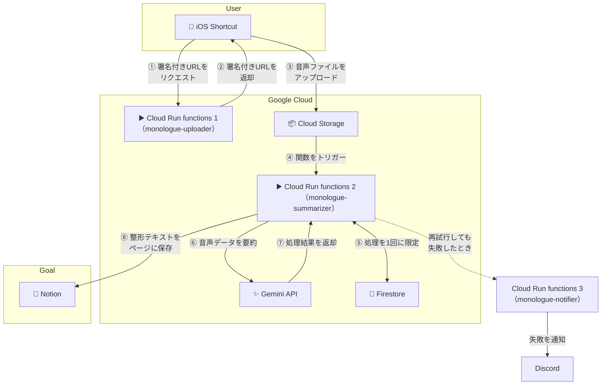
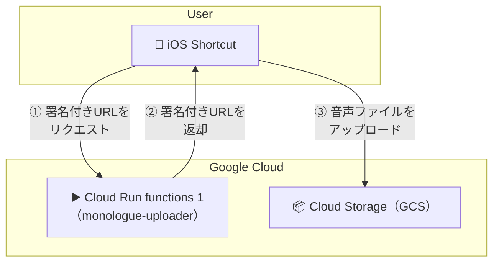
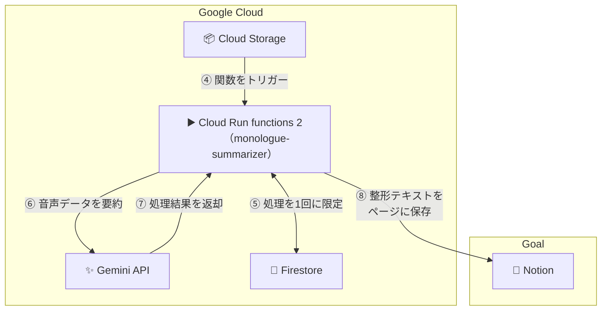

# monologue-muser

## 概要

ひとりごと(monologue) をきれいなメモに整形して Notion に格納するシステム。

## 使い方

1. ボイスメモで考えごとやメモしたいことを話す。
2. 共有メニューから iOS ショートカットを実行。
3. Notion にメモを文字起こししてまとめられた内容が格納される。

※ ボイスメモは`YYYYMMDD_title`という命名規則にして、`title` 部分を Notion のページ名にするようにしています。

## 使う前に知っておくこと

- **費用**: Gemini は [Google AI Studio](https://aistudio.google.com/apikey) の無料枠の API キーで呼びます。無料枠を使い切ると、同じモデルを Google Cloud の Agent Platform（旧 Vertex AI）で呼び直すため、従量課金が発生します。Google Cloud プロジェクトで課金を有効にしておく必要があります。Cloud Run・Cloud Storage・Firestore なども、無料枠を超えた分は課金されます。
- **データの扱い**: AI Studio の無料枠では、送った音声と生成結果が Google の製品改善に使われ、人が読む場合があります。機密情報や個人情報を話したメモは送らないでください。詳しくは [Gemini API の追加利用規約](https://ai.google.dev/gemini-api/terms) を確認してください。
- **認証**: アップロード用の関数（monologue-uploader）は iOS ショートカットから呼ぶため URL を公開しますが、API キー（`Authorization: Bearer <キー>`）が無い呼び出しは拒否します。キーは他人に渡さないでください。要約と通知の関数は公開せず、Eventarc からだけ呼ばれます。

## アーキテクチャ



- iOS ショートカット

  - [こちら](https://www.icloud.com/shortcuts/d32c5e50446a440da2784546cb6a5b59)からダウンロード。
    ※ ショートカットはこのリポジトリの MIT ライセンスの対象外です。許可なく二次配布はご遠慮いただきたいですが、個人利用の範囲内では自由に改造していただいて構いません。

- Cloud Storage (GCS; Google Cloud)

- Cloud Run functions (Google Cloud)

  - Python で実装
  - [Functions Framework](https://cloud.google.com/functions/docs/running/function-frameworks?hl=ja) を使用

  - 1 つ目: monologue-uploader（generate_signed_url）
    - iPhone から音声を GCS にアップロードするための署名付き URL を返す。API キーで呼び出し元を確かめる
  - 2 つ目: monologue-summarizer（monologue_summarizer）
    - GCS に アップロードされた音声ファイルを処理して Notion に格納
  - 3 つ目: monologue-notifier（monologue_notifier）
    - 要約が再試行しても終わらなかったとき（Pub/Sub のデッドレター）に、Discord へ知らせる

- Firestore (Google Cloud)
  - GCS トリガーで Cloud Run functions を実行する際に、Firestore で実行回数を制御しないと、複数回実行されてしまうことがある。
- Gemini

  - Gemini を使用して音声ファイルを文字起こし & 整形
  - 無料枠を活用したいため、まず [Google AI Studio](https://aistudio.google.com/apikey) の API キーで呼ぶ。無料枠を使い切ったら、Agent Platform（旧 Vertex AI）で同じモデルを従量課金で呼び直す。

- Notion

  - [Notion API](https://developers.notion.com/docs/getting-started) で指定したデータベースにデータを挿入。

## 開発

依存とテストは [uv](https://docs.astral.sh/uv/) で管理しています。依存の正本は `pyproject.toml` のサービス別グループと `uv.lock` で、各サービスの `requirements.txt` はそこから生成します。振る舞いの仕様は各サービスの `tests/` が正本です。

```bash
# 各サービスが main.py を持つため、テストはサービス単位で実行する
uv run pytest monologue-uploader
uv run pytest monologue-summarizer
uv run pytest monologue-notifier
# cloudbuild.yaml のデプロイ設定がコードの読む環境変数と一致するか
uv run pytest tests

# lint
uv run ruff check .
```

## セットアップ方法

### 前提

- 本リポジトリをローカルにクローン

```bash
git clone https://github.com/yasu-888/monologue-muser.git
```

- iPhone や iPad を使用

  - iOS ショートカットアプリを使用するため
  - 特定の GCS に音声ファイルをアップロードするリクエストを実行できれば、iPhone 以外からでも使用可能。

- Google Cloud プロジェクトを作成済み

  - [こちら](https://cloud.google.com/resource-manager/docs/creating-managing-projects?hl=ja) に沿ってセットアップ

- gcloud CLI をインストール済み

  - [こちら](https://cloud.google.com/sdk/docs/install?hl=ja)よりインストール
  - Cloud Run functions のデプロイ等に使用。
  - なくても構築は可能だが、ある方がコンソールの操作をスキップできる。

- 使う API を有効化済み

  ```bash
  gcloud services enable \
    run.googleapis.com cloudbuild.googleapis.com artifactregistry.googleapis.com \
    eventarc.googleapis.com pubsub.googleapis.com storage.googleapis.com \
    firestore.googleapis.com secretmanager.googleapis.com \
    iamcredentials.googleapis.com aiplatform.googleapis.com \
    --project [GoogleCloudのプロジェクトID]
  ```

  - `iamcredentials` は署名付き URL の署名に、`aiplatform` は無料枠を使い切ったときの Gemini の呼び直しに使う。

### ボイスメモをアップロードする仕組みを構築



1. GCS バケットを作成

   - 任意の名前（世界中で一意である必要がある）

2. GoogleCloud サービスアカウントの作成

   - 任意の名前（例: monologue-muser）

3. サービスアカウントにロールを付与

   - Cloud Datastore ユーザー `roles/datastore.user`
   - Eventarc イベント受信者 `roles/eventarc.eventReceiver`
   - Secret Manager のシークレット アクセサー `roles/secretmanager.secretAccessor`
   - Storage オブジェクトユーザー `roles/storage.objectUser`
   - サービス アカウント トークン作成者 `roles/iam.serviceAccountTokenCreator`
   - Vertex AI ユーザー `roles/aiplatform.user`（Gemini の無料枠を使い切ったとき、同じモデルを Agent Platform で従量で呼ぶため）

4. Cloud Run functions 1 (monologue-uploader) のデプロイは、後の「デプロイ」で 3 つの関数をまとめて行う

### 音声ファイルを処理する仕組みを構築



1. Firestore コレクションを作成

   1. (default) データベースを作成 ※ (default) 内では無料枠が適用されるため
   2. (default) データベース内に任意の名前（例: monologue-muser）コレクションを作成
   3. TTL ポリシーの有効化（定期的に自動で削除されるように）

      ```bash
      gcloud firestore fields ttls update expire_at --collection-group=[コレクション名] --enable-ttl
      ```

2. Notion データベースページ作成

   1. [こちら](https://www.notion.so/22114409fab580e79d81f4f7eda973e3?v=22114409fab5813487c2000c1e6633b1&source=copy_link) をコピーして出力先となるページを作成
   2. ページの URL からデータベース ID を取得
   3. `https://www.notion.so/XXXXXXXX?v=YYYYYYYY`」という形式の`XXXXXXXX`の部分がデータベース ID

3. Notion API 設定

   1. [こちら](https://www.notion.so/profile/integrations)からインテグレーションを作成
   2. `Insert content` に権限付与
   3. インテグレーションの `Internal Integration Secret` をコピー(NOTION_API_KEY)
   4. 先ほど作成したページで「3 点リーダー」→「Connections」→「Add connection」から作成したインテグレーションを追加

4. SecretManager に API キーを登録

   1. `gemini-free-api-key` で[Google AI Studio](https://aistudio.google.com/apikey) の API キーを設定。
   2. `notion-api-key` で Notion インテグレーションの`Internal Integration Secret` を設定。
   3. `discord-notify-bot-token` で、処理の失敗を知らせる Discord bot のトークンを設定（作り方は後の「失敗を Discord へ知らせる」）。
   4. `monologue-uploader-api-key` で、iOS ショートカットが monologue-uploader を呼ぶときの API キーを設定。推測されにくいランダムな値にする。

      ```bash
      openssl rand -hex 32 | tr -d '\n' | gcloud secrets create monologue-uploader-api-key --data-file=- --project [GoogleCloudのプロジェクトID]
      ```

### デプロイ

デプロイ設定の正本は `cloudbuild.yaml` です。3 つの関数（uploader・summarizer・失敗を Discord へ知らせる notifier）を並列にデプロイします。
個人の値は repo に置かず、`--substitutions` で渡します。API キーは Secret Manager の secret 名で参照します。

1. 3 つの関数をデプロイ

   ※ デプロイ用に gcloud login しておく

   ```bash
   gcloud auth login
   ```

   ```bash
   gcloud builds submit . \
     --config cloudbuild.yaml \
     --project [GoogleCloudのプロジェクトID] \
     --substitutions=_BUCKET_NAME=[GCSバケット名],_COLLECTION_NAME=[Firestoreコレクション名],_NOTION_DATABASE_ID=[NotionデータベースID],_DISCORD_NOTIFY_CHANNEL_ID=[DiscordチャンネルID],_RUNTIME_SERVICE_ACCOUNT=[サービスアカウント名]@[プロジェクトID].iam.gserviceaccount.com
   ```

   デプロイ後、Cloud Run のコンソールで `monologue-uploader` の `https://monologue-uploader-xxxxxxxx-an.a.run.app` のような URL をコピー

   summarizer と notifier は公開しないので、Eventarc が使うサービスアカウントに呼び出し権限を付ける。

   ```bash
   for service in monologue-summarizer monologue-notifier; do
     gcloud run services add-iam-policy-binding "$service" \
       --region=asia-northeast1 \
       --member=serviceAccount:[サービスアカウント名]@[プロジェクトID].iam.gserviceaccount.com \
       --role=roles/run.invoker
   done
   ```

2. iOS ショートカット初期設定

   - [こちら](https://www.icloud.com/shortcuts/d32c5e50446a440da2784546cb6a5b59)からショートカットをダウンロード
   - Cloud Run functions のエンドポイントを先ほどコピーしたものに設定
   - 署名付き URL を求めるリクエストのヘッダーに `Authorization: Bearer [monologue-uploader-api-key の値]` を設定
   - ショートカット内の `temp` の部分に iPhone 内の任意のフォルダを指定

   **テスト**

   実行してみて、ボイスメモが GCS にアップロードされるかを確認してみてください。


3. トリガーを設定

   これを設定することで、`③ 音声ファイルをアップロード`で Cloud Run functions 2 (monologue-summarizer)が発火します。

   既に `monologue-muser-trigger` を作成済みの場合は、新しいサービスへ転送するよう更新します。

   ```bash
   gcloud eventarc triggers update monologue-muser-trigger \
   --location=asia-northeast1 \
   --destination-run-service=monologue-summarizer \
   --destination-run-region=asia-northeast1
   ```

   ```bash
   gcloud eventarc triggers create monologue-muser-trigger \
   --destination-run-service=monologue-summarizer \
   --destination-run-region=asia-northeast1 \
   --event-filters="type=google.cloud.storage.object.v1.finalized" \
   --event-filters="bucket=[GCSバケット名]" \
   --service-account=[サービスアカウント名]@[プロジェクト ID].iam.gserviceaccount.com \
   --location=asia-northeast1
   ```

### 失敗を Discord へ知らせる

要約が再試行しても終わらないとき、Pub/Sub のデッドレターに落ちたイベントを monologue-notifier が受け取り、Discord に知らせます。使わない場合はこの節を飛ばしてかまいません（notifier はデプロイされても呼ばれないだけです）。

1. Discord bot を用意する

   1. [Discord Developer Portal](https://discord.com/developers/applications) でアプリケーションを作り、Bot のトークンを Secret Manager の `discord-notify-bot-token` に設定する。
   2. bot を通知先のサーバーに招待し、通知先チャンネルにメッセージを送る権限を付ける。
   3. Discord の開発者モードを有効にし、チャンネルを右クリック →「チャンネル ID をコピー」。デプロイの `_DISCORD_NOTIFY_CHANNEL_ID` に渡す。

2. デッドレターのトピックと、notifier へのトリガーを作る

   ```bash
   gcloud pubsub topics create monologue-dead-letter

   gcloud eventarc triggers create monologue-dead-letter-trigger \
   --location=asia-northeast1 \
   --destination-run-service=monologue-notifier \
   --destination-run-region=asia-northeast1 \
   --event-filters="type=google.cloud.pubsub.topic.v1.messagePublished" \
   --transport-topic=projects/[プロジェクトID]/topics/monologue-dead-letter \
   --service-account=[サービスアカウント名]@[プロジェクトID].iam.gserviceaccount.com
   ```

3. 要約のトリガーの購読に、デッドレター先を設定する

   購読の名前は Eventarc が自動で付けるので、先に調べます。

   ```bash
   SUBSCRIPTION=$(gcloud eventarc triggers describe monologue-muser-trigger \
     --location=asia-northeast1 --format='value(transport.pubsub.subscription)')
   PUBSUB_AGENT=service-[プロジェクト番号]@gcp-sa-pubsub.iam.gserviceaccount.com

   # Pub/Sub が、失敗したメッセージをデッドレターへ移せるようにする
   gcloud pubsub topics add-iam-policy-binding monologue-dead-letter \
     --member="serviceAccount:${PUBSUB_AGENT}" --role=roles/pubsub.publisher
   gcloud pubsub subscriptions add-iam-policy-binding "$SUBSCRIPTION" \
     --member="serviceAccount:${PUBSUB_AGENT}" --role=roles/pubsub.subscriber

   gcloud pubsub subscriptions update "$SUBSCRIPTION" \
     --dead-letter-topic=monologue-dead-letter --max-delivery-attempts=10
   ```

   notifier は、要約がまだ処理中（10 分未満）なら通知を保留して再配信を待ち、完了していれば通知しません。

## ライセンス

[MIT License](LICENSE)
